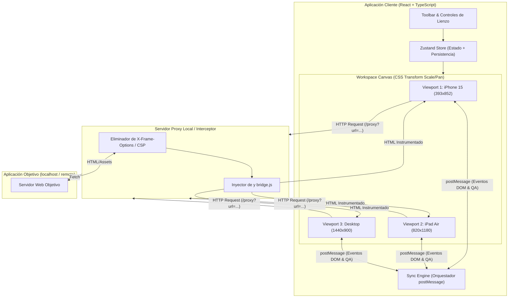
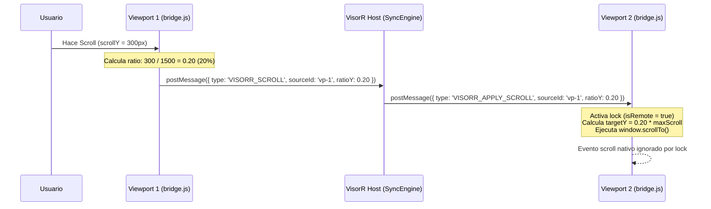

# Technical Architecture Document (TAD) - JkViwer

**Proyecto:** JkViwer  
**Versión:** 1.0  
**Enfoque Arquitectónico:** Arquitectura Híbrida Desacoplada (Web App + Local Interceptor Proxy + Injected Bridge Script, lista para empaquetarse también en Electron/Tauri).


---

## 1. Decisiones Arquitectónicas (ADRs)

### ADR-001: Arquitectura de Proxy Local + Inyección de Script (`bridge.js`)
* **Contexto:** Los navegadores modernos bloquean la carga de muchos sitios en `<iframe>` debido a cabeceras `X-Frame-Options` y `Content-Security-Policy`, e impiden el acceso al `contentWindow.document` por políticas de *Same-Origin (CORS)*.
* **Decisión:** Implementar un servidor ligero en Node.js (o middleware integrado en Vite/Express) que actúa como **Reverse Proxy Dinámico**. Este proxy:
  1. Descarga o hace streaming del recurso solicitado (`?url=https://...` o `http://localhost:xxxx`).
  2. Elimina las cabeceras `x-frame-options` y `content-security-policy`.
  3. Reescribe las rutas relativas (`<base href="...">`) e inyecta automáticamente antes del cierre de `</head>` un script ligero: `<script src="/__visorr_bridge__.js"></script>`.
* **Consecuencia:** VisorR funciona inmediatamente en cualquier navegador sin obligar al usuario a instalar extensiones ni compiladores pesados, y mantiene las puertas abiertas para empaquetarse con Electron en el futuro cambiando únicamente el adaptador de renderizado.

### ADR-002: Bus de Eventos Basado en `window.postMessage` con Prevención de Bucles (Echo Loop Prevention)
* **Contexto:** Cuando el `Viewport A` emite un evento `scroll` y el `Viewport B` actualiza su posición programáticamente (`window.scrollTo`), el `Viewport B` dispara a su vez un evento nativo `scroll`. Sin control, esto crea un bucle infinito de eventos cruzados.
* **Decisión:** Implementar un protocolo de sincronización con **Source Lock & Timestamp Window**:
  1. Cada viewport tiene un `deviceId` único.
  2. Cuando un viewport recibe una orden externa (`CMD_SYNC_SCROLL`), activa una bandera temporal `isApplyingRemoteEvent = true` durante el frame de animación (`requestAnimationFrame` + ventana de enfriamiento de `50ms`), ignorando la emisión de eventos salientes durante ese lapso.

### ADR-003: Gestión de Estado Centralizada con Zustand + Persistencia
* **Contexto:** El estado del lienzo (zoom, pan, lista de dispositivos, URL actual, estado de sincronización y alertas de QA por viewport) cambia frecuentemente.
* **Decisión:** Utilizar **Zustand** con el middleware `persist` para sincronizar el estado de configuración con `localStorage`, separando las acciones de alta frecuencia (como coordenadas de scroll) en el `SyncEngine` fuera del ciclo de re-renderizado de React.

---

## 2. Diagrama de Arquitectura del Sistema



---

## 3. Flujo de Sincronización de Eventos (Sequence Diagram)



---

## 4. Estructura de Directorios del Proyecto

```text
e:\proyectos\visorr\
├── specs/                          # Especificaciones SDD (Single Source of Truth)
│   ├── 01-prd.md                   # Requisitos del Producto y Criterios Gherkin
│   ├── 02-architecture.md          # Arquitectura Técnica y ADRs
│   ├── 03-contracts.md             # Contratos de Datos, Tipos e Interfaces
│   └── 04-tasks.md                 # Plan de Ejecución e Hitos de Desarrollo
├── src/
│   ├── types/                      # Implementación de los contratos de 03-contracts.md
│   │   └── index.ts
│   ├── constants/                  # Catálogo de dispositivos y presets de breakpoints
│   │   └── devices.ts
│   ├── store/                      # Estado global (Zustand)
│   │   └── useVisorStore.ts
│   ├── services/                   # Motores de negocio desacoplados de la UI
│   │   ├── syncEngine.ts           # Orquestador del bus postMessage
│   │   └── urlHelper.ts            # Normalizador de URLs y generador de rutas proxy
│   ├── bridge/                     # Script inyectado dentro de los iframes objetivo
│   │   └── bridgeScript.ts         # Captura de scroll, clicks, inputs y auditoría QA
│   ├── components/
│   │   ├── Topbar/                 # Barra de URL, toggles de sincronización, zoom, tema
│   │   ├── Sidebar/                # Selector de dispositivos, presets, custom viewport
│   │   ├── Canvas/                 # Lienzo infinito/grid y contenedor con escala CSS
│   │   └── Viewport/               # Marco de dispositivo, cabecera, badges QA, iframe
│   ├── App.tsx
│   └── main.tsx
├── server/                         # Middleware / Proxy Interceptor para bypass de headers
│   └── proxyPlugin.ts              # Plugin de Vite / Express para reescritura e inyección
└── tests/                          # Pruebas unitarias y de contratos
```

---

## 5. Estrategia para Modos de Carga (Modo Directo vs. Modo Proxy)
Algunas aplicaciones en `localhost` utilizan WebSockets específicos de Vite/Webpack HMR con rutas relativas que funcionan mejor de manera directa si no tienen cabeceras de bloqueo, mientras que sitios externos o con bloqueos requieren el Proxy.
* **Modo Proxy (Por defecto para compatibilidad total):** Reescribe el HTML a través de `/__visorr_proxy__?url=...`, elimina cabeceras de bloqueo e inyecta automáticamente `bridge.js` para habilitar sincronización total y detector de overflow.
* **Modo Directo (Fallback o manual):** Carga la URL directamente en el `src` del `<iframe>` y ofrece un *snippet* de 1 línea o script para proyectos locales que deseen sincronización nativa con HMR intacto.
